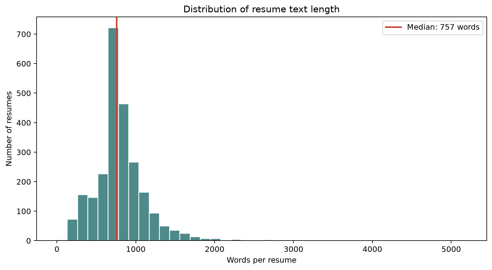
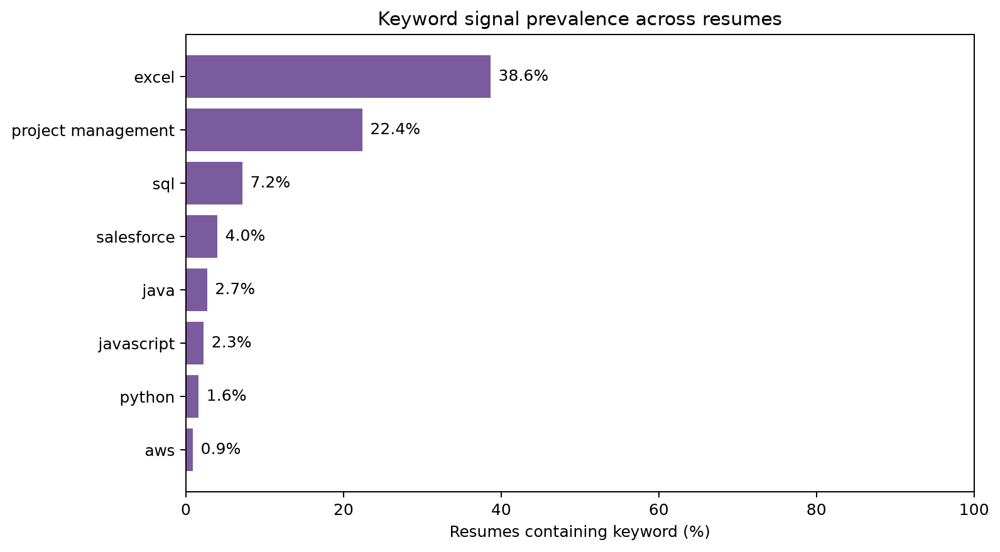
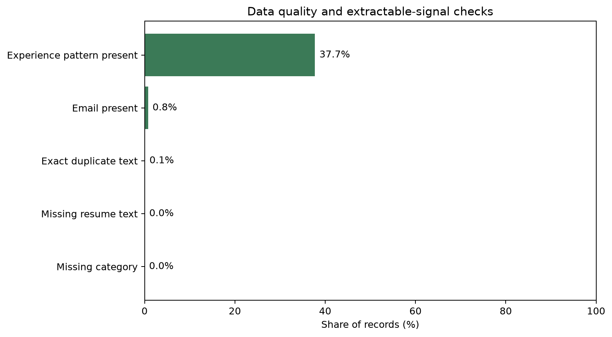
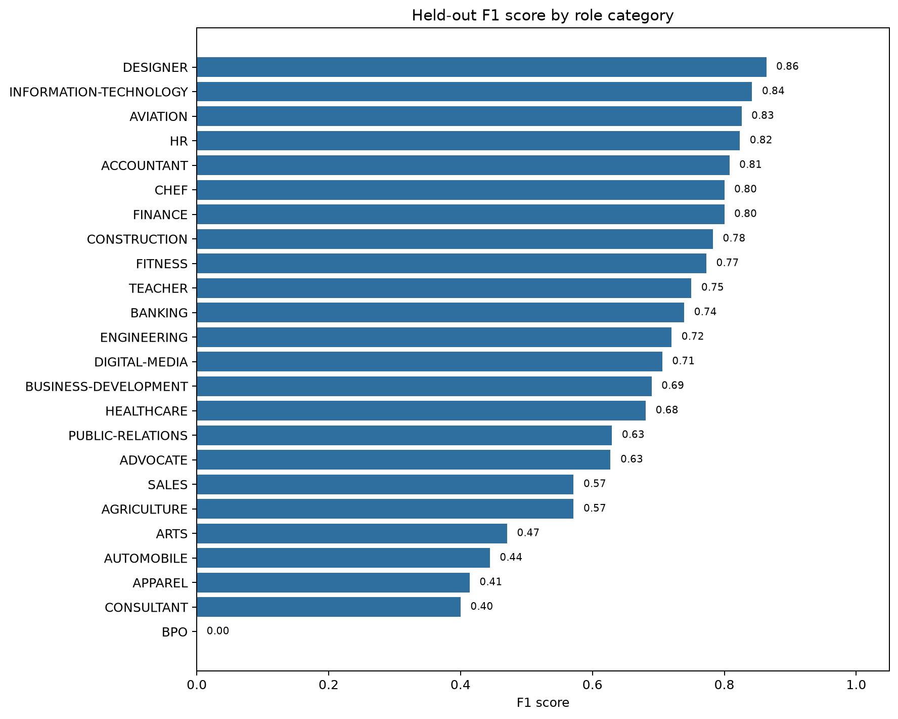
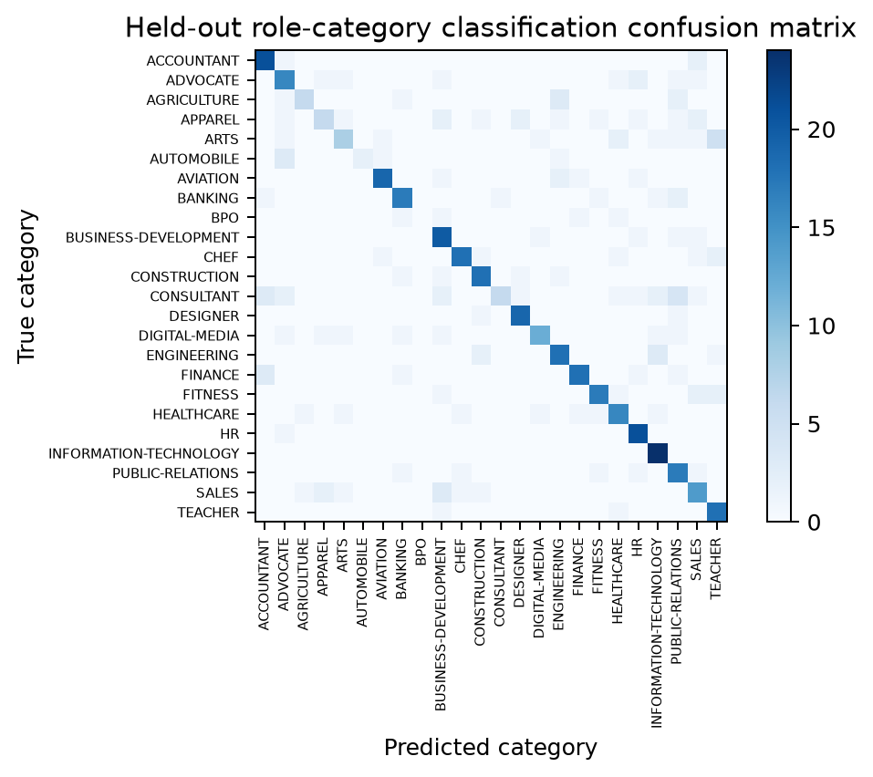
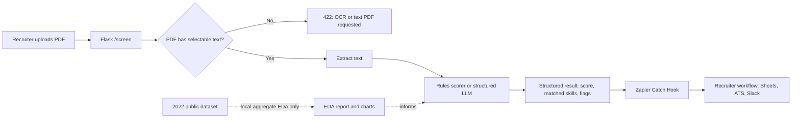

# Resume Screening Automation: 2022 Dataset EDA Report

## Purpose and data governance

This report evaluates the project’s data pipeline using the public **Resume Dataset** published by Snehaan Bhawal (2022). The dataset contains resume examples originally scraped from LiveCareer and is distributed with text, HTML, an ID, and a job-category label. This repository uses it for aggregate exploratory analysis only; it does **not** commit raw resumes, IDs, HTML, email addresses, or PDFs.

Source: [Kaggle dataset](https://www.kaggle.com/datasets/snehaanbhawal/resume-dataset) · [Hugging Face CSV mirror](https://huggingface.co/datasets/Divyaamith/Kaggle-Resume)

## Reproducibility

```powershell
New-Item -ItemType Directory -Force data\raw | Out-Null
curl.exe -L --fail --output data\raw\Resume.csv "https://huggingface.co/datasets/Divyaamith/Kaggle-Resume/resolve/main/Resume.csv?download=true"
python -m pip install -r requirements-eda.txt
python scripts\run_eda.py
```

`data/raw/` and `reports/metrics.json` are intentionally ignored by Git. The script emits only aggregate figures and a local metrics file.

## Dataset profile

The analysis processed **2,484 resumes** across **24 labeled job categories**. The data is imbalanced: Information Technology and Business Development have 120 resumes each, while BPO has 22 and Automobile has 36. Any category classifier or score calibration should therefore use stratified splits and report per-category results rather than only an overall metric.


The median resume contains **757 words**; the 95th percentile is **1,398.7 words**. This range supports the API’s file and text-length validation, but it also means a fixed prompt/input limit could disproportionately truncate long resumes.



## Text-signal EDA

Keyword signals vary substantially. Excel appears in **38.65%** of resumes and “project management” in **22.38%**, while Python appears in **1.61%** and AWS in **0.89%**. These are corpus-wide terms, not candidate-quality labels. A single universal technical-skills threshold would be inappropriate across the dataset’s 24 occupations; job-specific criteria must drive scoring.



Quality checks found **0.04%** missing resume text, **0%** missing category labels, and **2 exact duplicate texts**. Only **0.76%** of resumes contain an extractable email pattern, reinforcing why the API treats email as an optional flag rather than a screening requirement. An explicit years-of-experience pattern appears in **37.72%** of records, so experience should not be inferred when the format does not expose it.



## Held-out role-category classification baseline

To add a concrete supervised benchmark, the project evaluates a **TF-IDF plus LinearSVC** classifier against the dataset's 24 job-category labels. This is a text-classification task, not a prediction of employment outcomes or candidate suitability.

Methodology:

- Removed the one record with blank resume text, leaving **2,483** records.
- Used an **80/20 stratified train-test split** with `random_seed=42`: **1,986** training records and **497** held-out test records.
- Converted text into lower-cased English-stopword-filtered TF-IDF unigrams and bigrams, capped at 15,000 features.
- Trained a linear support-vector classifier (`LinearSVC`) only on the training partition.

| Metric | Held-out result |
| --- | ---: |
| Accuracy | 70.62% |
| Macro precision | 69.91% |
| Macro recall | 66.19% |
| Macro F1 | 65.55% |
| Weighted F1 | 69.12% |



The per-category view is essential: Designer (F1 **0.86**) and Information Technology (F1 **0.84**) classify well in this split, while BPO has F1 **0.00** on only four held-out examples. The macro F1 score prevents large or easier categories from hiding weaker minority-category performance.



The full machine-readable [evaluation output](category-classification-metrics.json) records the model configuration, split, aggregate metrics, and per-category results. Reproduce it with `python scripts\evaluate_category_baseline.py` after downloading the local CSV.

## Findings and limitations

1. The data is suitable for text-extraction checks, category exploration, and testing that the pipeline handles varied resume formats.
2. The `Category` field is a job-domain label—not an employment outcome or ground-truth job-fit score. This dataset cannot justify claims about screening precision, recall, fairness, or employment-outcome accuracy.
3. Before deploying a recommendation threshold, obtain consented, role-specific resume–job pairs with independent human suitability labels. Evaluate precision, recall, false-positive/negative rates, calibration, and disparate impact on a held-out set.
4. The source contains potentially personal resume content. Preserve data minimization: analyze locally, retain only aggregate outputs, and never send resumes to Zapier or an LLM without a lawful basis and explicit policy.
5. The supervised metrics above evaluate category labels only. They must not be presented as hiring accuracy, candidate quality, or job-fit accuracy.

## System architecture



## Claim boundary

This project demonstrates an auditable automation workflow and real-dataset EDA. It is configured as decision support, not as an automated employment-decision system. Final workflow disposition remains with an authorized reviewer.
